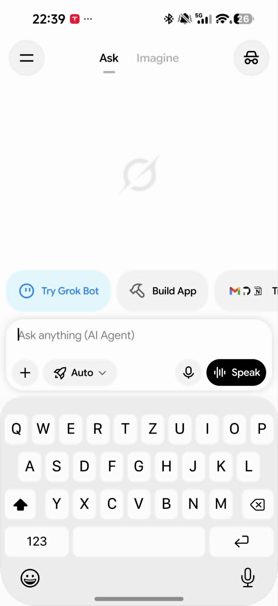
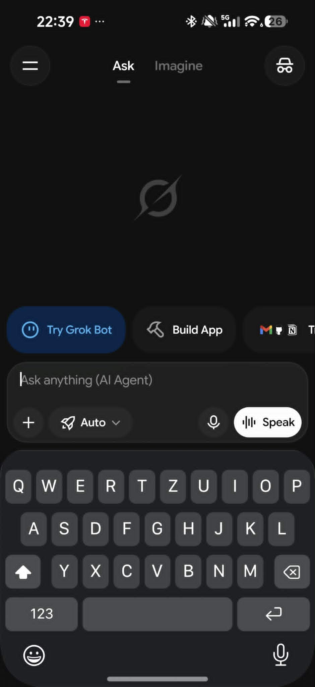

# iOS Keyboard for Android

Many of us find Android keyboards hard to get used to after using an iPhone. I started this project to make that transition easier, with a familiar layout and typing experience on Android.

An iOS-inspired, open-source Android keyboard with Hungarian typing, conservative offline
autocorrection, accent popups, emoji search, and optional Google speech recognition.
Licensed under **GPL-3.0-only**, with separately licensed components listed in
[third-party notices](THIRD_PARTY_NOTICES.md).

This is a **development preview**, not a stable release. Android 13 or newer is
required. The default native build targets ARM64; an x86_64 build is available for
emulator testing. It does not bundle Apple fonts, Apple emoji, reference screenshots,
or traced screenshot artwork. Letter labels use Inter; key rectangles are generated
from row rules and icons are drawn in code.

## What works

- A real Android input method: typing into other apps, editor actions, selection
  replacement, grapheme deletion, accent choices and spacebar cursor movement.
- Offline AOSP LatinIME correction, a suggestion strip and immediate Backspace undo.
- Emoji categories, recents, skin-tone choices and CLDR search keywords.
- Theme, feedback, keyboard-height and typing-behavior settings.
- Optional speech recognition through Google's installed recognizer or the system
  fallback. **Audio may leave the phone.** See [privacy](PRIVACY.md).

Language definitions, dictionaries and emoji keywords cover English, Hungarian,
German, French, Spanish, Italian, Brazilian Portuguese, Polish and Dutch. The
settings language picker and Android subtype declarations still expose Hungarian
and English only; the nine-language settings UI and translations are unfinished.
Do not interpret the presence of dictionaries as measured correction quality in
all nine languages. The Portuguese dictionary here is the original OpenBoard
version, rather than the separately patched variant used in private development.

## Screenshots

<p>
  
  
</p>

Light and dark modes, shown in the Grok app. Captured from the private development
build before the public-source artwork changes; the publication candidate uses
Inter labels and code-drawn icons. Grok's interface is shown only as the host app.

## Build and contribute

See [build instructions](docs/BUILD.md), [contributing](CONTRIBUTING.md),
[architecture](docs/ARCHITECTURE.md), [license review](docs/LICENSING.md),
and the [publication checklist](docs/OPEN-SOURCE.md).

```sh
python3 tools/verify_engine_sources.py
python3 tools/verify_public_release.py
cd ui-demo
./gradlew --no-daemon :app:assembleDebug :app:testDebugUnitTest :app:lintDebug
```

The debug application ID is `hu.keyboard.proof.debug`, so testing it does not
replace the earlier private application. Enable it in Android's input-method
settings, then select it using the system input-method picker.

## Limitations

No local speech engine, swipe typing, next-word prediction or personal-dictionary
learning is implemented. Landscape behavior, accessibility and compatibility with
more host apps need further validation. Gboard or iOS parity is not claimed.
Public production signing and an update channel have not been established.

This project is independent of Apple, Google, OpenBoard and HeliBoard.
