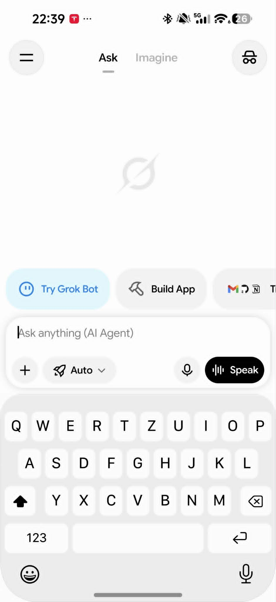
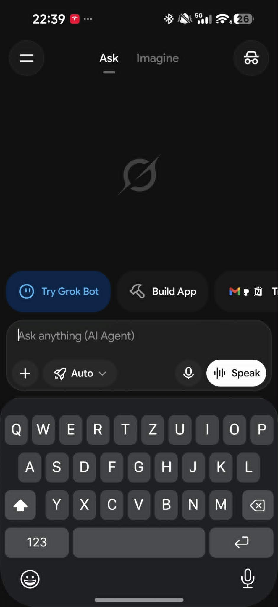

# iOS Keyboard for Android


An open-source, iPhone-style keyboard for Android 13+, with an iOS-inspired layout,
offline autocorrection, nine typing languages, long-press accents and emoji search.
Optional dictation uses an external Android speech recognizer.

Many of us find Android keyboards hard to get used to after using an iPhone. I started
this project to make that transition easier, with a familiar layout and typing experience
on Android.

Licensed under **GPL-3.0-only**, with separately licensed components listed in
[third-party notices](THIRD_PARTY_NOTICES.md).

This is a **development preview**, not a stable release. Android 13 or newer is
required. The default APK includes ARM64 and 32-bit ARM libraries; x86/x86_64 builds are
available for emulator testing. See the [compatibility matrix](docs/COMPATIBILITY.md)
for tested configurations and physical-device gaps. It does not bundle Apple fonts, Apple emoji, reference screenshots,
or traced screenshot artwork. Letter labels use Inter; key rectangles are generated
from row rules and icons are drawn in code.

## Download and install

1. Download the signed APK from [GitHub Releases](https://github.com/Yxonyx/ios-keyboard-for-android/releases).
2. Install it, open the app, and enable it in Android keyboard settings.
3. Choose it in the system keyboard picker. Hold the space bar to cycle through
   the typing languages selected in settings.

The release is a **development preview**. Verify the APK checksum and signing
certificate using the [release guide](docs/RELEASE.md). Updates signed with the same
release key retain settings. A debug-signed development installation has a different
identity and cannot be updated in place by the release APK. Export or record your
settings before choosing to replace a development build; do not uninstall merely
to bypass an unexplained signature error. The `.debug` package installs separately.

To build it yourself, follow the [pinned toolchain instructions](docs/BUILD.md).

## What works

- A real Android input method: typing into other apps, editor actions, selection
  replacement, grapheme deletion, accent choices and spacebar cursor movement.
- Offline AOSP LatinIME correction, a suggestion strip and immediate Backspace undo.
- Emoji categories, recents, skin-tone choices and CLDR search keywords. Swipe the
  grid in either direction to change pages; hold an emoji to see its skin-tone variants.
- Swipe down on the keyboard to hide it while you read, close to dragging the page on iOS;
  tap the text field to bring it back.
- Theme, feedback, keyboard-height and typing-behavior settings.
- Optional speech recognition through Google's installed recognizer or the system
  fallback. **Audio may leave the phone.** See [privacy](PRIVACY.md).

Language definitions, dictionaries and emoji keywords cover English, Hungarian,
German, French, Spanish, Italian, Brazilian Portuguese, Polish and Dutch. The
settings expose all nine typing languages and their layouts, plus a selectable
language cycle using a long press on the space bar. The interface is translated into the same nine languages
and can follow Android or use an independent application language.
Do not interpret the presence of dictionaries as measured correction quality in
all nine languages. The Portuguese dictionary here is the original OpenBoard
version, rather than the separately patched variant used in private development.

## Screenshots

<p>
  
  
</p>

Light and dark modes, shown in the Grok app. Captured from the private development
build before the public-source artwork changes; the publication candidate uses
Inter labels and code-drawn icons. Grok's interface is shown only as the host app.

For recognizer setup, live partial text and microphone troubleshooting, see
[dictation](docs/DICTATION.md).

## Known limitations

- Android 13 or newer; physical validation across manufacturers is still incomplete.
- The experimental Android 15 16 KB emulator currently fails app-test editor
  connection preparation. Native tests passed there; full IME validation is pending.
- Emoji metadata covers 3,972 records. The nine component-only records are not
  standalone keys; the other 3,963 sequences are reachable through categories and
  variant selection. Rendering still depends on the installed emoji font. A check
  with the sampled Xiaomi font reported 19 unsupported sequences; this is not a
  universal count. See [emoji coverage](docs/COMPATIBILITY.md#emoji-coverage).
- Dictionaries are included for nine languages; correction quality has not been
  measured equally across those languages.
- Optional dictation uses an external recognizer and may upload audio. It needs a
  compatible, configured provider and microphone permission; language/model,
  connectivity, Android/OEM audio policy and partial-result support vary. The
  dictation fix was confirmed by the user on a Xiaomi / Android 16 phone, not on
  every manufacturer. See [dictation evidence and limits](docs/DICTATION.md).

## Frequently asked questions

### Can I get an iPhone-style keyboard on Android?

That is what this project provides: a separate Android keyboard inspired by the iOS
layout and typing experience. It is not an Apple product and does not include Apple
fonts or emoji artwork. Install the signed APK above; Android 13 or newer is required.

### Does this Android keyboard work offline?

Typing, autocorrection and emoji search work locally without an account or Internet
permission. Optional dictation is separate: the installed speech provider may need a
network connection and may upload audio. See [privacy](PRIVACY.md).

### Does it support Hungarian and accented letters?

Yes. Hungarian supports QWERTZ and QWERTY, with long-press choices for Á, É, Í, Ó, Ö,
Ő, Ú, Ü and Ű. Eight other typing languages are included; see the language list above.

## Privacy and the Android keyboard warning

Typing, autocorrection and emoji search run locally. There is no account, analytics,
phone-to-developer server or background GitHub connection. GitHub hosts the source;
it is not a runtime backend. **Optional external dictation may upload audio to the
installed recognizer, usually Google**, and needs separate first-use approval plus
microphone permission. Local typing continues if you decline it.

Android warns when enabling a third-party keyboard because an input method can
receive typed text. That standard warning alone is not a malware verdict. It also
does not prove that any APK with this name is safe: verify the download source and
the exact warning. Play Protect alerts and signature mismatches must be assessed
separately. See [privacy and warning explanations](PRIVACY.md), also available
inside application settings.

## Build and contribute

See [build instructions](docs/BUILD.md), [contributing](CONTRIBUTING.md),
[architecture](docs/ARCHITECTURE.md), [license review](docs/LICENSING.md),
and the [publication checklist](docs/OPEN-SOURCE.md).

```sh
python3 tools/verify_engine_sources.py
python3 tools/verify_public_release.py
cd ui-demo
./gradlew --no-daemon :app:assembleDebug :app:testDebugUnitTest :app:lintDebug
```

The debug application ID is `hu.keyboard.proof.debug`, so testing it does not
replace the earlier private application. Enable it in Android's input-method
settings, then select it using the system input-method picker.

## Limitations

No local speech engine, swipe typing, next-word prediction or personal-dictionary
learning is implemented. Landscape behavior, accessibility and compatibility with
more host apps need further validation. Gboard or iOS parity is not claimed.
Public production signing and an update channel have not been established.

This project is independent of Apple, Google, OpenBoard and HeliBoard.
